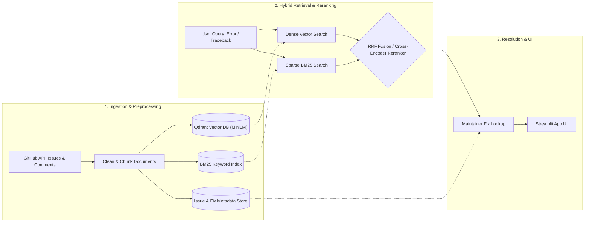

# GitHub ErrorLens - Architecture

Horizontal architecture diagram showing each block of the RAG system across ingestion, hybrid retrieval, and presentation pipelines.

---

## Core Blocks Overview

### 1. Ingestion & Preprocessing
- **Data Fetcher** (`scripts/fetch_issues.py`): Collects closed issues and discussion comments via the GitHub REST API.
- **Cleaner & Splitter** (`main.py`): Strips issue templates/checklists (`clean`) and chunks text with `RecursiveCharacterTextSplitter`.
- **Dual Indexing & Storage**:
  - Dense embeddings via `all-MiniLM-L6-v2` stored in Qdrant (`data/qdrant`).
  - Sparse keyword index built in-memory with `BM25Okapi` (`rag_engine/search.py`).
  - Metadata registry loaded by `load_issue_info` (`rag_engine/issues.py`).

### 2. Hybrid Retrieval & Reranking
- **Dense Search** (`search_vector`): Retrieves semantic context from Qdrant.
- **Sparse Search** (`search_bm25`): Captures exact token/traceback matches.
- **Fusion & Reranking**: Merges candidates using Reciprocal Rank Fusion via `rrf` or scores candidate chunks with `search_rerank` using `cross-encoder/ms-marco-MiniLM-L-6-v2`.

### 3. Resolution & UI
- **Fix Resolution** (`rag_engine/issues.py`): Maps top-ranked issue IDs back to author/maintainer solutions.
- **Web Interface** (`app/streamlit_app.py`): Interactive search interface displaying ranked issues, state reasons, and verified fixes.
